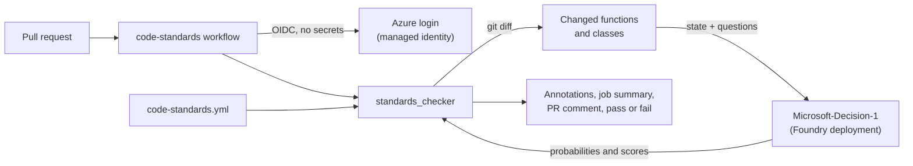

# Decision-1 code standards check (proof of concept)

A GitHub Action that checks pull requests against coding standards written in plain English, using
[Microsoft-Decision-1](https://learn.microsoft.com/azure/foundry/foundry-models/how-to/use-foundry-models-microsoft-decision)
in Microsoft Foundry. The standards live in one YAML file. You change what gets enforced, how strict
each rule is, and whether it blocks the merge without touching code.

The code under test is a small Flask REST API for a bookstore (backend only, no frontend).

> **Status:** proof of concept. Microsoft-Decision-1 is a preview model in Foundry, and the Foundry model
> catalog lists an inference retirement date of 2027-02-04 for version 1. Expect the API and model to change.

## What it does

On every pull request the workflow:

1. Finds the Python functions, classes and module-level code that the PR changed.
2. Sends each code unit to Decision-1 with one question per standard (up to 10 questions per request).
3. Compares the returned probability or score with the limit you set for that standard.
4. Reports the results:
   - inline annotations on the changed code,
   - a job summary and a single PR comment that is updated on every push,
   - a JSON artifact with every score,
   - a failed check if any `error` standard is violated. `warning` standards annotate but never block.

Decision-1 doesn't write prose. It answers typed questions with numbers: `noul` (yes/no) returns the
probability that the answer is yes, and `score` returns a position on an ordered scale. That makes it fast
(about 2 seconds per code unit here), cheap in output tokens, and easy to threshold, but it also means a
finding tells you *which* function broke *which* rule, not why.

## How it works



Each request looks like this. The `state` is the code unit with line numbers plus a short project
context; the questions come straight from the YAML file.

```json
{
  "model": "decision-1",
  "state": "Project context: Python 3.12 Flask REST API ...\nFile: bookstore/routes/reviews.py\nCode unit: function create_review (lines 23-36)\n\n  23 | @reviews_bp.post(\"\")\n  24 | def create_review():\n ...",
  "questions": {
    "parameterized_sql": {
      "type": "noul",
      "instructions": "Does this code put runtime values into an SQL statement using f-strings ...?",
      "criteria": { "true": "Values ... are interpolated into SQL text.", "false": "Values are passed separately ..." }
    },
    "readability": {
      "type": "score",
      "instructions": "How readable and maintainable is this code for another engineer on the team?",
      "criteria": ["very poor", "poor", "acceptable", "good", "excellent"]
    }
  }
}
```

## Adjusting the standards

Everything is in [`.github/code-standards.yml`](.github/code-standards.yml). A rule looks like this:

```yaml
- id: correct-http-status
  description: Responses must use the HTTP status code that matches the outcome.
  type: noul            # yes/no question; phrase it so "yes" means a violation
  severity: warning     # error = fail the check, warning = annotate only, off = skip
  threshold: 0.6        # fire when P(yes) >= 0.6
  paths: ["bookstore/routes/**"]
  instructions: >-
    Does this Flask route handler return the wrong HTTP status code for what happened, ...?
  criteria:
    true: At least one response uses a status code that does not match the outcome.
    false: Status codes match the outcome (200 for reads and updates, 201 for create, ...).
```

| To do this | Change |
|---|---|
| Make a standard block merges | `severity: error` |
| Report a standard without blocking | `severity: warning` |
| Turn a standard off | `enabled: false` or `severity: off` |
| Make a yes/no rule stricter or looser | lower or raise `threshold` (0 to 1) |
| Make a score rule stricter or looser | raise or lower `min_score` (0 to number of labels minus 1) |
| Apply a rule to some files only | `paths: ["glob/**"]` |
| Add a standard | add a rule with a new `id`, `instructions` and optional `criteria` |
| Check the whole repo instead of the diff | run the workflow manually with `scope: all`, or set `settings.scope: all` |

The shipped file has eight active rules and one disabled example (`type-hints`):

| Rule | Type | Severity | Fires when |
|---|---|---|---|
| `no-hardcoded-secrets` | noul | error | p >= 0.50 |
| `parameterized-sql` | noul | error | p >= 0.50 |
| `no-swallowed-exceptions` | noul | error | p >= 0.60 |
| `validate-request-input` | noul | warning | p >= 0.60 (routes only) |
| `correct-http-status` | noul | warning | p >= 0.60 (routes only) |
| `logging-not-print` | noul | warning | p >= 0.60 |
| `docstrings` | noul | warning | p >= 0.70 |
| `readability` | score | warning | score < 1.75 on a 0 to 4 scale |
| `type-hints` | noul | warning | disabled |

Tips for writing rules:

- Phrase `noul` questions so that **yes means a violation**. The checker fires when the yes-probability
  reaches the threshold.
- Add `criteria` for anything borderline. When `correct-http-status` didn't mention "200 for updates",
  a correct `PUT` handler scored 0.44. After adding it, the same handler scored 0.01.
- Use `settings.context` to tell the model about project conventions, such as where validation helpers live.
- Start new rules as `warning`, watch the scores in the PR comment's "Rules evaluated" table, then promote
  them to `error` once the threshold is reliable.

## Calibration

The thresholds were set by running every rule against the clean bookstore app and a deliberately bad
module ([the demo pull request](#demo) adds it). The gap between the two columns is the safety margin.

| Rule | Worst result on the clean app | Results on the planted violations |
|---|---|---|
| `no-hardcoded-secrets` | p = 0.00 | p = 1.00 |
| `parameterized-sql` | p = 0.07 | p = 1.00 (three handlers) |
| `no-swallowed-exceptions` | p = 0.01 | p = 1.00 |
| `validate-request-input` | p = 0.00 | p = 1.00 (two handlers) |
| `correct-http-status` | p = 0.02 | p = 0.82 to 0.99 |
| `logging-not-print` | p = 0.01 | p = 1.00 |
| `docstrings` | p = 0.15 | p = 0.99 |
| `readability` | score = 2.40 | score = 0.26 to 1.46 |

Treat these as a starting point. Microsoft's guidance is to validate thresholds against your own labeled
examples before you automate a gate, and to prefer `score` results for relative ordering rather than as
absolute ratings.

## Demo

The [`demo/violations`](../../compare/main...demo/violations) branch adds `bookstore/routes/reviews.py`
with a hardcoded API key, string-built SQL, a bare `except`, `print()` calls, unvalidated input and
wrong status codes. Its pull request shows the failed check, the inline annotations and the results comment.

## Setup

### 1. Azure

You need a Foundry (Azure AI Services) resource in a region that offers Microsoft-Decision-1, and
permission to create deployments, managed identities and role assignments.

[`infra/setup-azure.sh`](infra/setup-azure.sh) does the rest and is safe to re-run. It:

- deploys `Microsoft-Decision-1` (default name `decision-1`, `DataZoneStandard`),
- creates a user-assigned managed identity and grants it **Cognitive Services User** on the resource,
- adds federated credentials for this repository's pull requests and `main` branch (OIDC, no stored secrets).
  It reads the subject prefix from GitHub, because repositories created after July 15, 2026 use
  [immutable subject claims](https://learn.microsoft.com/entra/workload-id/workload-identities-github-immutable-subjects)
  such as `repo:owner@123/repo@456:pull_request`,
- sets the repository variables the workflow reads.

```bash
SUBSCRIPTION=<subscription> RESOURCE_GROUP=<resource-group> FOUNDRY_ACCOUNT=<foundry-resource> \
GITHUB_REPO=<owner>/<repo> ./infra/setup-azure.sh
```

Capacity: each capacity unit allows about one request per minute, and one request covers one code unit
(up to 10 rules). Set `SKU_CAPACITY` to roughly the number of changed functions you expect per minute of PRs.

### 2. GitHub repository variables

The script sets these with `gh variable set`. They are identifiers, not secrets.

| Variable | Example |
|---|---|
| `AZURE_CLIENT_ID` | client ID of the managed identity |
| `AZURE_TENANT_ID` | your Microsoft Entra tenant ID |
| `DECISION_ENDPOINT` | `https://<foundry-resource>.cognitiveservices.azure.com` |
| `DECISION_DEPLOYMENT` | `decision-1` |

### 3. Workflows

- [`code-standards.yml`](.github/workflows/code-standards.yml) runs on pull requests to `main` and on demand.
  It signs in to Azure with OIDC and calls the composite action in
  [`.github/actions/decision-standards`](.github/actions/decision-standards/action.yml).
- [`ci.yml`](.github/workflows/ci.yml) runs the unit tests, `ruff`, and an offline dry run of the
  checker (`--mock`) that validates the standards file without calling the model.

To make the standards check required, add **Decision-1 standards** as a required status check in a
branch ruleset for `main`.

### Using the action from another repository

The composite action finds the checker relative to its own path, so other repositories can call it
directly after their own `azure/login` step:

```yaml
- uses: sabajamalian/decision-model-code-standards/.github/actions/decision-standards@main
  with:
    endpoint: ${{ vars.DECISION_ENDPOINT }}
    deployment: ${{ vars.DECISION_DEPLOYMENT }}
    config: .github/code-standards.yml
    base-ref: origin/${{ github.base_ref }}
```

## Run it locally

```bash
python -m venv .venv && source .venv/bin/activate
pip install -r requirements-dev.txt

# Offline: validates the config and wiring, reports everything as passing
python -m standards_checker --scope all --mock

# Live: uses your Azure CLI sign-in
az login
export DECISION_ENDPOINT=https://<foundry-resource>.cognitiveservices.azure.com
python -m standards_checker --scope all
python -m standards_checker --files bookstore/routes/books.py --json-out results.json
python -m standards_checker --base-ref origin/main          # only what changed on this branch
```

Credentials are picked in this order: `DECISION_API_KEY` (if key auth is enabled on the resource),
`DECISION_TOKEN` (a bearer token), then `az account get-access-token`. Set `DECISION_AZ_SUBSCRIPTION`
to pick the subscription for the Azure CLI token.

Exit codes: `0` passed (warnings allowed), `1` an `error` standard was violated, `2` the config was
invalid, git failed, or some Decision-1 requests failed.

## The sample app

A small Flask 3 API backed by SQLite. It follows the standards above so the check passes on `main`.

| Method | Path | Notes |
|---|---|---|
| GET | `/health` | liveness |
| GET, POST | `/books` | list (`limit`, `offset`) and create |
| GET, PUT, DELETE | `/books/<id>` | read, replace, delete |
| GET, POST | `/authors` | list and create |
| GET | `/authors/<id>` | read |
| GET | `/authors/<id>/books` | books by author |

```bash
flask --app bookstore init-db
flask --app bookstore run
curl localhost:5000/books
python -m pytest
```

## Limits and caveats

- **Preview model.** Request and response shapes may change before general availability.
- **Findings point at code units, not lines.** Decision-1 returns numbers without explanations, so the
  checker reports the function or class that broke a rule. Very long units are split into windows of
  `max_chunk_lines`.
- **Probabilities, not proofs.** A model-based check can miss things or flag correct code. Keep
  deterministic tools (linters, type checkers, secret scanning, CodeQL) for what they already do well,
  and use this for standards that are hard to express as static rules, like "status codes match the
  outcome" or "input is validated before use".
- **Annotation limits.** GitHub shows at most 10 error and 10 warning annotations per step inline. The PR
  comment and JSON artifact always list everything.
- **Fork pull requests** don't get OIDC tokens or write access, so the check can't call Azure or comment
  for PRs from forks. This setup is meant for branches in the same repository.
- **Code leaves the repository.** Changed code is sent to your Foundry deployment. `DataZoneStandard`
  keeps inference in the deployment's data zone; review your organization's policies before using it on
  private code.

## Repository layout

```text
bookstore/                         Flask app under test
standards_checker/                 the checker (config, chunking, git diff, client, reports, CLI)
tests/                             app tests and checker tests (no network calls)
.github/code-standards.yml         the adjustable standards
.github/actions/decision-standards composite action
.github/workflows/                 code-standards.yml (Decision-1) and ci.yml
infra/setup-azure.sh               Azure deployment, identity, OIDC and repo variables
```

## License

[MIT](LICENSE)
